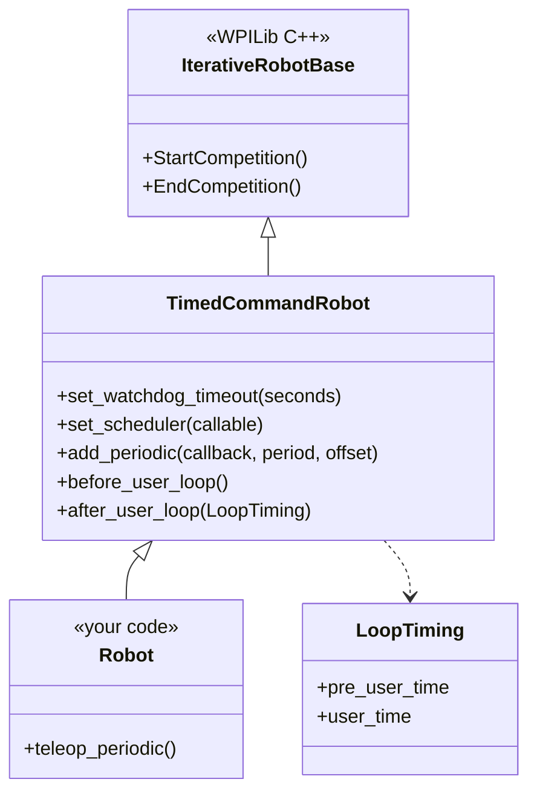
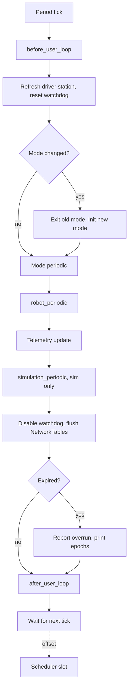
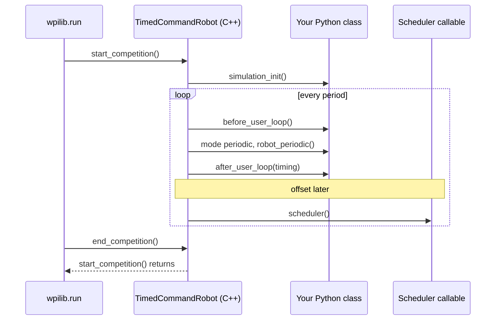

# TimedCommandRobot — User Guide

`cpy6107.TimedCommandRobot` is a C++ robot base class, exposed to Python with nanobind, for
robotpy teams on **FRC 2027** (robotpy `wpilib==2027.0.0a6`). It behaves like `wpilib.TimedRobot`
but with two additions:

* **A settable watchdog timeout.** `TimedRobot`'s watchdog is private, so a subclass (for example
  AdvantageKit-style `LoggedRobot`) cannot change when a loop overrun is reported.
  `TimedCommandRobot` owns its watchdog and exposes `set_watchdog_timeout()`.
* **Hooks and a scheduler slot.** `before_user_loop()` / `after_user_loop()` bracket every loop
  cycle (useful for logging), and a second slot per period runs a command scheduler at a fixed
  offset after the main loop.

This guide assumes you are comfortable with Python classes and with robotpy's `TimedRobot`
and `commands2`.

## 1. Install

```bash
python3.14 -m venv .venv && . .venv/bin/activate
pip install --pre "wpilib==2027.0.0a8" nanobind scikit-build-core
CXX=g++-14 pip install --no-build-isolation --no-deps -e .   # from the repository root
```

See [INSTALL.md](INSTALL.md) for the C++ presets, tests and coverage. Wheels are not published
yet; the extension is built from source against the WPILib libraries in the `robotpy-native`
wheels.

## 2. A minimal robot

```python
import wpilib
from cpy6107 import TimedCommandRobot


class Robot(TimedCommandRobot):
    def __init__(self) -> None:
        super().__init__()            # 20 ms period, 5 ms scheduler offset
        self.set_watchdog_timeout(0.04) # report an overrun only after 40 ms

    def robot_periodic(self) -> None:
        pass

    def teleop_periodic(self) -> None:
        pass


if __name__ == "__main__":
    wpilib.run(Robot)
```

`wpilib.run()` is duck-typed: it constructs the class and calls `start_competition()`. The
class does **not** derive from `wpilib.TimedRobot`, so `isinstance(robot, wpilib.TimedRobot)` is
`False` (nanobind and pybind11 types cannot inherit from each other).

Constructor arguments are in **seconds**: `TimedCommandRobot(period=0.02, scheduler_offset=0.005)`.
A `period <= 0` or `scheduler_offset < 0` raises `ValueError`.

## 3. Lifecycle hooks

Override any of these (names are the robotpy 2027 snake_case names). The defaults do nothing, and it is
fine to call `super()`.

| Hook | When it runs |
| --- | --- |
| `driver_station_connected()` | Once, the first cycle the driver station is attached |
| `simulation_init()` | Once, at start (simulation) |
| `disabled_init()`, `autonomous_init()`, `teleop_init()`, `utility_init()` | On entering the mode |
| `disabled_exit()`, `autonomous_exit()`, `teleop_exit()`, `utility_exit()` | On leaving the mode |
| `disabled_periodic()` … `utility_periodic()` | Every cycle in that mode |
| `robot_periodic()` | Every cycle in all modes, after the mode periodic |
| `simulation_periodic()` | Every cycle in simulation, last |
| `before_user_loop()` | Before the loop body, outside the watchdog window |
| `after_user_loop(timing)` | After the loop body, outside the watchdog window |

Disabled is treated as its own mode (`disabled_init` / `disabled_periodic`).

`after_user_loop` receives a `LoopTiming` with read-only `pre_user_time` (time in `before_user_loop`)
and `user_time` (mode periodic + `robot_periodic` + `simulation_periodic`), both in seconds:

```python
from cpy6107 import LoopTiming, TimedCommandRobot


class Robot(TimedCommandRobot):
    def before_user_loop(self) -> None:
        self._log_inputs()

    def after_user_loop(self, timing: LoopTiming) -> None:
        self._log_outputs(user_ms=timing.user_time * 1000.0)
```

## 4. The watchdog

Every cycle the watchdog starts when the loop body starts and is disabled when it ends. If the
body takes longer than the timeout, the overrun is reported (`Loop time of 0.0xxxxxs overrun`) and
the per-section epochs are printed.

```python
robot.set_watchdog_timeout(0.1)     # seconds, > 0, else ValueError
robot.get_watchdog_timeout()        # default: equal to the period
robot.add_watchdog_epoch("vision")  # add a named epoch from your own code
robot.print_watchdog_epochs()       # print them (use this, not the inherited method)
```

Hooks `before_user_loop`/`after_user_loop` run **outside** the watchdog window, so their time never
causes an overrun report; it is visible in `LoopTiming`. Epochs are only valid while a cycle is in
progress (inside the hooks and periodic methods).

### Overrun callback

```python
def on_overrun(info: cpy6107.OverrunInfo) -> None:
    print(f"loop took {info.loop_time:.4f}s (timeout {info.timeout:.4f}s)")

robot.set_overrun_callback(on_overrun)   # None clears it; call before start_competition()
```

The callback runs on the robot thread after each cycle whose watchdog expired, in addition to the
standard error report. `loop_time` covers `before_user_loop` plus the loop body.

### Errors in hooks

By default an exception in `before_user_loop`, `after_user_loop` or the overrun callback is
reported through the WPILib error log and counted (`robot.get_hook_error_count()`); the robot keeps
running. To stop the robot and re-raise from `start_competition()` instead:

```python
robot.set_hook_error_policy(cpy6107.HookErrorPolicy.STOP)   # default: LOG_AND_CONTINUE
```

The policy covers only these hooks. An exception in `robot_periodic`, the mode methods, or the
scheduler callable always propagates out of `start_competition()`.

## 5. The command scheduler slot

Each period has two callbacks, both on the robot thread:

1. the **loop slot** (mode and robot periodic methods), and
2. the **scheduler slot**, `scheduler_offset` seconds later.

Splitting them lets the scheduler run after the robot has produced its latest outputs and lets
you tune how much of the period each gets.

```python
import commands2
from cpy6107 import TimedCommandRobot


class Robot(TimedCommandRobot):
    def __init__(self) -> None:
        super().__init__(period=0.02, scheduler_offset=0.005)
        self.set_scheduler(commands2.CommandScheduler.getInstance().run)
        self.add_periodic(self._update_leds, period=0.1, offset=0.01)

    def _update_leds(self) -> None: ...
```

* `set_scheduler(callable)` / `clear_scheduler()` — one callable per robot.
* `add_periodic(callback, period, offset=0.0)` — extra periodic callbacks.
* Call both **before** `start_competition()`. They are not thread-safe once running.

### Diagrams







## 6. Threading and the GIL

The loop runs in C++ on the thread that called `start_competition()`.

* The GIL is **released** while the loop waits and **acquired** around every call into Python
  (hooks, scheduler, periodic callbacks). Other Python threads therefore run between callbacks.
* A Python exception in a hook or the scheduler stops the loop and is raised from
  `start_competition()`.
* `end_competition()` is safe from any thread and is idempotent; `wpilib.run` may log
  "Unexpected return from start_competition()" after a normal stop. It is cosmetic.
* Hooks are called every cycle even if you do not override them, at the cost of one GIL
  acquire each. Keep Python hooks short: the loop body must fit in the watchdog timeout.

## 7. Migrating from `lib_6107` `LoggedRobot`

| `LoggedRobot` | `TimedCommandRobot` |
| --- | --- |
| Setting a watchdog has no effect (the base watchdog is private) | `set_watchdog_timeout(seconds)` works |
| `loopFunc` / logging around the loop | `before_user_loop()` / `after_user_loop(timing)` |
| Base class `IterativeRobotBase` (Python) | `TimedCommandRobot` (C++); not a `wpilib` subclass, pass to `wpilib.run` as usual |
| Scheduler registered via `add_periodic` | `set_scheduler(callable)` with a dedicated offset slot |

Steps: change the base class, move logging code into `before_user_loop` / `after_user_loop`,
set the timeout you want (AdvantageKit uses 4 × period; this library defaults to 1 × period), and
register the command scheduler with `set_scheduler`. The full lib_6107 walk-through, with a tested
replacement `LoggedRobot`, is in `docs/LIB_6107_INTEGRATION.md`.

## 8. Limitations

* Supports robotpy **2027.0.0a8** and **a6** (a7 is untested). a8 needs glibc >= 2.41 at runtime (Debian 13, Ubuntu 25.04+), which Ubuntu 24.04 does not provide; see `docs/INSTALL.md` for the Docker image.
* Linux only for now; the SystemCore ARM64 preset builds the C++ core, not yet the framework.
* A `TimedCommandRobot` is not a `wpilib.TimedRobot`; code that checks for that type must be
  adjusted.
* WPILib's own epoch bookkeeping allocates on every cycle; this is upstream behaviour.
